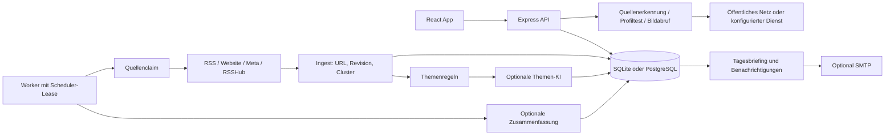

# NEWSDECK: Codequalitätsanalyse

Stand: 10.11.2026. Grundlage ist der lokale Projektstand in `C:/Users/Moritz/Documents/ChatGPT/Newsdeck`. Es wurden keine Implementierungs-, Konfigurations- oder Migrationsdateien geändert. Ergebnisdateien sind diese Analyse und `CODEQUALITAET-PLAN-2026-11-10.md`.

## 1. Ergebnis und Reichweite

Die Anwendung hat eine brauchbare, bewusst kleine Architektur und bemerkenswert gute Tests für mehrere schwierige Fachregeln. Ein Neuaufbau ist nicht gerechtfertigt. Vorrang haben die getrennte RSSHub-Lieferkette, sichere Fehlerantworten, atomare Themenänderungen, nachgewiesene PostgreSQL-Kompatibilität und verlässliche asynchrone UI-Abläufe. Danach folgen Typverträge, kleinere Module und messbare Datenbankoptimierungen.

Untersucht wurden alle 22 eigenen Servermodule, beide Frontenddateien, fünf Testdateien, sieben SQL-Dateien, zehn Dateien unter `scripts/`, vier PowerShell-Einstiegsskripte, Paketmanifest und Lockfile, TypeScript/Vite/Docker/Compose-Konfiguration, HTML-Einstieg, Beispielquellen und die vorhandenen sieben Markdown-Dokumente einschließlich README. Die installierte separate RSSHub-Version und ihr Lockfile wurden in die Abhängigkeitsprüfung einbezogen. Generierte Dateien, fremder Bibliotheksquellcode und historische Binärartefakte sind keine zeilenweise geprüfte eigene Codebasis.

Der Ordner ist aktuell **kein Git-Repository**: `git status --short` meldet „not a git repository“. Commit-Historie, Branches, frühere Änderungen und entfernte CI-Konfiguration lassen sich deshalb nicht bewerten. Es gibt lokal keine `.github`-Pipeline und keine ESLint-Konfiguration. Die vom Nutzer mitgegebenen Arbeitsregeln wurden berücksichtigt; weitere projektspezifische AGENTS-Dateien wurden nicht gefunden.

Produktive Datenbank, Zugangsdaten und Sitzungen wurden nicht inhaltlich ausgelesen. Bei `.env` wurde nur nach Namen mit dem öffentlichen Vite-Präfix gesucht; keine solchen Namen gefunden. ZIP-Prüfung ausschließlich auf Eintragsnamen: 48 Einträge, keine Treffer für `.env`, `data/`, `backups/`, `session.dpapi` oder `Zugang.txt`. Das ist kein vollständiger Inhalts-Geheimnisscan. Historische Screenshots und Live-Prüfprotokolle sind keine aktuelle Browserabnahme.

## 2. Reproduzierte Prüfungen

| Prüfung | Ergebnis und Grenze |
|---|---|
| Laufzeit | Node 24.15.0, npm 11.12.1 unter Windows |
| `npm ls --depth=0` | Direkte installierte Pakete stimmen mit den angeforderten Versionen überein |
| `npm run check` | Erfolgreich; gilt nur für den derzeitigen tsconfig-Umfang |
| `npm test` | **52 bestanden, 0 fehlgeschlagen, 0 übersprungen**, ca. 6,2 Sekunden; temporäre SQLite-Datenbanken und simulierte Dienste |
| Frontend-Build | Erfolgreich mit Vite 7.3.7; Ausgabe absichtlich in temporären Ordner, bestehendes `dist/` nicht ersetzt |
| Build-Größe | JS 249,04 kB / gzip 77,26 kB; CSS 24,11 kB / gzip 5,92 kB; kein Beleg für einen akut zu großen Bundle |
| `npm audit --json --ignore-scripts` | Hauptprojekt: **0 gemeldete Schwachstellen**, 313 Abhängigkeiten laut npm-Metadaten |
| `npm audit --prefix .rsshub --json --ignore-scripts` | Getrennte RSSHub-Installation: **12 betroffene Pakete: 4 high, 8 moderate, 0 critical**, 669 Abhängigkeiten laut npm |
| Prettier `--check` auf TS/TSX/CSS/MJS und Root-JSON/TS/YAML | Formatabweichungen in **24 Dateien**; nichts formatiert |
| Docker-Verfügbarkeit | CLI vorhanden, Docker-Engine nicht erreichbar; **kein** Container-, PostgreSQL- oder Restore-Laufzeittest |
| Isolierter API-Fehler | Simulierter DB-Fehler in `/api/health` ergibt HTTP **400** und `{"error":"synthetic internal database detail"}` |
| Isolierte Themenkonkurrenz | Mit Barriere nach beiden Eltern-Leseabfragen liefern zwei gegensätzliche PUTs jeweils **200**; Ergebnis A→B und B→A |

Tests wurden mit abgekoppelter dotenv-Datei und neutralisierten externen Zugangseinstellungen gestartet. Kein Live-Worker, Backfill, Quellenimport, E-Mail-Versand oder externer KI-Aufruf wurde ausgelöst. Der erste Build- und Auditversuch scheiterte an Ausführungs-/Netzwerkbeschränkungen; der anschließende erlaubte Lauf war erfolgreich. Diese ersten Fehlschläge sind keine Projektdefekte.

Die Themenreproduktion verwendet eine temporäre In-Memory-Datenbank und verzögert ausschließlich die Rückgabe zweier bereits gelesener Elternwerte. Sie belegt die fehlende atomare Prüfung bei einem möglichen Interleaving, nicht die Häufigkeit im Produktivbetrieb. Ein erster unkontrollierter Parallelversuch erzeugte keinen Zyklus.

## 3. Tatsächlicher Stack

| Bereich | Stand |
|---|---|
| UI | React / React DOM 19.2.0, lucide-react 0.468.0, eigenes CSS, keine Router-/Query-/Form-Bibliothek |
| Build/Typen | TypeScript 5.9.3, Vite 7.3.7, React-Plugin 5.1.0, tsx 4.20.6, Prettier 3.6.2 |
| HTTP | Express 5.1.0, Helmet 8.1.0, express-rate-limit 8.7.2, cookie-parser 1.4.7 |
| Verträge/Konfiguration | Zod 4.6.7, dotenv 17.2.3; überwiegend manuelle ENV-Auswertung |
| Speicherung | `node:sqlite` DatabaseSync lokal; pg 8.16.3; PostgreSQL-17-Image für Compose |
| Inhalte | fast-xml-parser 5.11.2, Cheerio 1.1.2, native HTTP/HTTPS-Clients und fetch |
| Integrationen | OpenAI-kompatibles Chat-Completions-HTTP-Protokoll; Meta Business Discovery; Nodemailer 10.3.1 |
| Tests | `node:test` über tsx; Playwright 1.64.1 als Bibliothek für Instagram-Prototyp, keine Browser-Regressionssuite |
| RSSHub | Eigene Installation `1.0.0-master.986522c`; im Compose-Override dagegen bewegliches `diygod/rsshub:latest` |

`@types/nodemailer` 7.0.3 und Nodemailer 10.3.1 haben unterschiedliche Hauptversionen. Das allein beweist keinen Typfehler, verlangt aber eine bewusste Kompatibilitätsprüfung beim nächsten Update. Node-/npm-Versionen sind im README beschrieben, jedoch nicht durch `engines`/`packageManager` im Manifest festgelegt. Der Lockfile-Stand ist vorhanden; ein frisches `npm ci` wurde im Analyseauftrag nicht ausgeführt.

## 4. Architektur und Datenfluss

Die SQL-Datenbank ist die gemeinsame Wahrheit für zwei Prozesse. Es gibt keine Mandantentrennung; Artikel, Themen, Quellen und Ordner sind gemeinsam, Favoriten und Benachrichtigungen benutzerbezogen. Der API-Prozess bedient statische Frontenddateien. Quellenerkennung, Profiltests und Bildproxy führen allerdings sehr wohl Netzwerkzugriffe im Requestpfad aus; nur reguläre Quellenjobs sind ausgelagert.

`src/main.tsx` umfasst 2.533 Zeilen und vereint Anmeldung, Navigation, Polling, sieben Ansichten, Modale, Formularlogik und API-Client. `server/api.ts` umfasst rund 900 Zeilen und vereint HTTP-Schemas, Autorisierung, SQL und Domänenabläufe. Dagegen sind Quellenordner, Veröffentlichungsdatum, Briefings und Themenklassifikation bereits sinnvoll ausgelagert. `server/db.ts` erzeugt beim Import sofort eine globale Verbindung; `config.ts` lädt ENV beim Import. Mehrere reine Hilfsimporte ziehen dadurch indirekt persistente Infrastruktur nach sich. `connectors.ts` und `rsshub.ts` importieren sich gegenseitig.

## 5. Stärken, die erhalten bleiben müssen

- SQL-Werte werden gebunden. Dynamische Sortierausdrücke stammen aus validierten Enums; hier wurde keine direkte SQL-Injection nachgewiesen.
- SQLite nutzt WAL, Fremdschlüssel, busy_timeout und eine Queue, die Transaktionen innerhalb des Prozesses isoliert. PostgreSQL-Transaktionen benutzen korrekt einen einzelnen Pool-Client. Migrationen werden atomar und unter Sperren angewandt.
- HTTP-Abrufe prüfen öffentliche Adressen, pinnen die geprüfte DNS-Adresse, prüfen Redirectziele erneut und begrenzen Antwortgröße und einzelne HTTP-Anfragen. DTD/ENTITY in Feeds werden abgewiesen; `processEntities` ist deaktiviert.
- Sessions bestehen aus zufälligen Tokens; gespeichert wird ihr Hash. Cookies sind HttpOnly/SameSite strict. Schreibzugriffe verlangen den konfigurierten Origin; Rollen werden serverseitig geprüft. Der anmeldungsfreie Modus ist auf konkrete Loopback-/Host-Bedingungen begrenzt.
- Artikel- und Themen-KI validieren Ergebnisse. Themenbelege müssen im Text vorkommen. Manuelle Themenzuordnungen, Katalogrevisionen und laufende Jobtokens schützen gegen mehrere Arten veralteter KI-Antworten.
- Veröffentlichungstage unterscheiden sich bewusst von Abrufdaten. DST-Grenzen, unklare Datumswerte, Zukunftszeitpunkte, nachträgliche Änderungen und Briefing-Triggers sind getestet. Präzision über Millisekunden hinaus ist absichtlich erhalten.
- Quellenlöschung erhält Artikel; Ordnerlöschung erhält Quellen. Versions-2-Import und Legacy-Import sind getestet. Teilweise erfolgreiche Imports sind ausdrücklich Produktverhalten.
- Docker läuft bereits als Nicht-root, mit read-only Root-Dateisystem, reduzierten Fähigkeiten und begrenzter Containerloggröße. SQLite-Backup nutzt die dafür vorgesehene API.

## 6. Befundregister

Kennzeichnung: **B** = direkt aus Code/Prüfung belegt; **R** = zusätzlich isoliert reproduziert; **H** = begründetes Risiko ohne Laufzeitnachweis; **O** = offener Nachweis. P1 = vor Freigabe bzw. vor größerem Umbau, P2 = nächste Qualitätsiteration, P3 = messwertabhängig/später. Kein bestätigter akuter P0-Vorfall.

| ID | Prio / Beleg | Fundstelle / konkrete Folge |
|---|---|---|
| F01 | P1 B/O | `.rsshub/package-lock.json`, `scripts/rsshub-package.json`: Hauptaudit deckt RSSHub nicht ab. 12 Paketmeldungen, darunter RSSHub und basic-ftp. Betroffene Route und Commit-Abstammung noch zu verifizieren. |
| F02 | P1 R | `server/api.ts:885` Fehlerhandler: interne Fehler werden 400, rohe `err.message` geht nach außen. Auch Health liefert damit falsche Fehlerklasse. Parser-413 kann zu 400 werden. |
| F03 | P1 R | `server/api.ts:285,300,315`: `validateTopic` läuft vor Katalogsperre/Transaktion. Zwei gleichzeitig gültige Änderungen erzeugen gemeinsam einen Zyklus. |
| F04 | P1 O | Alle Tests erzwingen SQLite. PostgreSQL-spezifische Trigger, Volltextsuche, Locking und Migrationen haben keinen aktuellen automatisierten Laufzeitbeleg. |
| F05 | P1 B/H | `src/main.tsx:314`: Artikeldetailantworten haben keinen Sequenz-/Abbruchschutz. A langsam, B schnell kann A zuletzt anzeigen; Schließen kann durch spätere Antwort rückgängig werden. |
| F06 | P1 B/H | `src/main.tsx:2291`: Quellenerkennung schreibt nach await den alten vollständigen Formularstand zurück. Zwischenzeitliche Namens-/Ordner-/URL-Änderungen können verloren gehen. |
| F07 | P1 B/H | `server/worker.ts:21`, `server/jobs.ts:29`: Leaseverlängerungen prüfen keine betroffenen Zeilen; Fehler werden nur geloggt. Ein alter Worker kann nach Übernahme weiterarbeiten. Artikel-Ingest ist nicht an Quellen-Token gebunden. |
| F08 | P1 B/H | `server/api.ts:533`: Quellen-Lease wird vor separatem DELETE gelesen. Claim kann dazwischen erfolgen; Fehler bis zur FK-Verletzung im Ingest/Log möglich. |
| F09 | P1 B | `compose.rsshub.yaml`: offizieller RSSHub-Container umgeht die lokale eigene Hülle mit robots-Preflight, Routeneinschränkung und Einzelflug. Gleiche Quellentypbezeichnung, unterschiedliche Schutzwirkung. |
| F10 | P2 B | `server/db.ts:6`, `src/main.tsx:32`: `Record<string, any>` macht strict an zentralen Datenkanten wirkungslos. 57 Vorkommen des Tokens `any` in untersuchten TS/TSX-Dateien, inklusive Tests. API und DB verwenden unterschiedliche boolesche/JSON-Formen ohne explizite DTO-Grenze. |
| F11 | P2 B | `tsconfig.json`: Script-TS ist nicht regulär enthalten; MJS ungeprüft; DOM und Node teilen einen Kontext. `tests/instagram-session.test.ts` verwendet `@ts-ignore`. Lintskript und Hooks-Regeln fehlen. |
| F12 | P2 B | `server/api.ts:639,644`: Feed lädt `a.*` samt Volltext, löscht content erst danach und macht pro Artikel eine Themenabfrage: bei 30 Artikeln 32 Datenabfragen ohne Auth-/Transaktionskommandos. Themen werden außerhalb des Listensnapshots gelesen. |
| F13 | P2 B/H | `server/db.ts:110`: Auch reine Listen-Lesetransaktionen verwenden `BEGIN IMMEDIATE`; sie reservieren SQLite-Schreibzugriff. Synchrone DB-API blockiert während Arbeit/Wartezeit den jeweiligen Node-Eventloop. |
| F14 | P2 B | `server/auth.ts:13,17`, Loginroute: synchrones scrypt im Webprozess; unbekannte E-Mail berechnet Dummyhash und Verifikation neu, bekannte E-Mail nur Verifikation. Ungleicher Aufwand und vermeidbare Blockierung. |
| F15 | P2 B | `src/main.tsx:151,237,263,379,527`: /me-Fehler werden verschluckt; 401 später wird nicht zentral behandelt; Login-Nachabruf/Logout haben ungeschützte Fehlerpfade; Polling überlappt und Sequenzschutz fehlt bei Jobs/Briefings/Settings. |
| F16 | P2 B | `server/config.ts`, direkte ENV-Leser: Zahlen, Origins, Zeitzone und Integrationskombinationen werden uneinheitlich geprüft. Tippfehler können verspätet als Provider-/Startfehler erscheinen. Keine sichere Gesamtvalidierung. |
| F17 | P2 B/H | `server/network.ts`: DNS erfolgt vor dem Requesttimer; Redirect-/robots-Kette hat keine gemeinsame Deadline. Gleichzeitige Requests können denselben Host-Zeitabstand parallel abwarten. Maps haben keine Größenbegrenzung. |
| F18 | P2 B/H | `server/network.ts:robotsAllowed`: eigener Parser mit Regex, ohne umfassende RFC-/Encoding-Fixtures. Konservative IP-Präfixlogik und crawl-delay aller Gruppen sind Produktrestriktionen, keine vollständige Standardimplementierung. Kein SSRF-Bypass nachgewiesen. |
| F19 | P2 B | `server/ai.ts:32`, `connectors.ts:fetchInstagramMeta`: JSON-Bodies ohne Byteobergrenze; KI-fetch ohne `redirect:'error'`. Antwortform teils any. Timeout allein begrenzt Speicher nicht. |
| F20 | P2 B | `processing.ts:137`: Zusammenfassungen wiederholen unbegrenzt; Themenprüfung stoppt dagegen nach drei Versuchen. SMTP stoppt nach acht Versuchen, behält aber status pending. Endzustände und manuelle Wiederaufnahme fehlen. |
| F21 | P2 B/H | `worker.ts`, `index.ts`: Worker beendet erst nach ganzem Zyklus; ein Zyklus kann viele Minuten dauern. Keine durchgehende Abbruchkette. Web-Shutdown hat keine Deadline. Initialer Claimfehler liegt außerhalb des tick-catch. |
| F22 | P2 B | `worker-health.ts`, `/api/status`: unterschiedliche 120-/90-Sekunden-Grenzen; globaler Heartbeat belegt keinen Fortschritt und keine Gesundheit dieser konkreten Instanz. |
| F23 | P2 B | `api.ts`, `jobs.ts`, `network.ts`, `connectors.ts`: verstreute console-/Leer-catch-Pfade. Kein gemeinsamer Ereignistyp, Request-ID oder systematischer Geheimnisfilter. Teilweise übersprungene Feed-/Websiteeinträge unsichtbar. |
| F24 | P2 B/H | `/api/export`, Artikeldetails und Briefings: unbeschränkter Vollarchivexport im Speicher, inkonsistente Tabellenzeitpunkte; vollständige Revisionen/Cluster und bis 30 Tagesbriefings pro Antwort. Wachstum nicht gemessen. |
| F25 | P2 B | `Dockerfile`: finale Stufe übernimmt komplettes node_modules einschließlich Build-/Browserwerkzeugen. `tsx` ist devDependency, aber Produktionsstart benötigt es; schlichtes `--omit=dev` bricht den Start. |
| F26 | P2 B | `Setup-RSSHub.ps1`: `npm install` statt reproduzierbarem `ci`; gesondertes Lockfile liegt nur in ignorierter Installation. Compose verwendet latest. Windowsstart baut nur bei fehlendem dist, nicht bei veraltetem dist. |
| F27 | P2 B | Tests teilen innerhalb mehrerer Dateien Zustand zwischen Fällen; dotenv-Einstellungen sind nicht überall vollständig isoliert. Keine Browser-, SMTP-, Mehrprozess-/Leaseverlusttests oder Coverage-Auswertung. Gute Fachtests sind keine allgemeine Vollabdeckung. |
| F28 | P2 B/H | `Modal` ab `src/main.tsx:2063`: globaler DOM-Selektor statt Dialog-Ref; unsichtbare Elemente nicht ausgefiltert. Import-Input ist CSS display:none und dessen Label nicht tastaturfokussierbar. Mobile Sidebar nur transformiert, ohne inert/aria-expanded. |
| F29 | P2 B | Dokumentation driftet: Architektur verweist für KI-Transport auf processing statt ai; neue Tabellen fehlen. README behauptet „Bilder werden nicht übernommen“, tatsächlich werden Bild-URLs gespeichert und Bilder proxiert/umgeleitet. Abnahme enthält ältere 25/28/30/31-Teststände und ältere Meta-Grenzen. |
| F30 | P2 B/H | `scripts/backup.sh`: direkt endgültiger Dateiname, Fehler können Restdatei hinterlassen. Restore --clean entfernt keine neueren Objekte, die im alten Dump fehlen. Restorebeleg fehlt; SQLite-Onlinebackup selbst ist korrekt gewählt. |
| F31 | P2 B | `scripts/import-requested-sources.mjs`: datierter einmaliger Import, feste localhost-URL, Änderungen an Prüfergebnissen, Aktivierung/Rechte aus `entry.ok`; kein allgemeines wiederverwendbares Importwerkzeug. `verify-live.ts --after-restart` verlangt exakte Bestandszahl trotz aktivem Worker. |
| F32 | P3 B/H | `db.ts:27,95`: pauschales Ersetzen aller `?` ist nur für den derzeit verwendeten SQL-Teilbereich passend; Stringliterale, Kommentare und PostgreSQL-JSON-Operatoren können künftig beschädigt werden. Kein aktueller SQL-Fehler damit nachgewiesen. |
| F33 | P3 B | `connectors.ts`, `rsshub.ts`: Feedparser und Connectorregistry bilden Zyklus. Encoding pauschal UTF-8; fremde JSON-LD-Typen können Extraktion abbrechen. Unterschied gültig leerer Feed / vollständig verworfene Einträge nicht diagnostiziert. |
| F34 | P3 H | Fehlende spezialisierte Indizes, tiefe OFFSET-Seiten, häufige COUNTs und Titelvergleich können mit Archivgröße teuer werden. Bestehende Indizes und ein kleiner Bundle rechtfertigen zunächst Messung statt Infrastrukturwechsel. |
| F35 | P2 B | `server/db.ts:122`, Importketten von auth/processing/connectors: DB-Verbindung entsteht bereits beim Modulimport. Reine Parser-/Regeltests und Hilfsskripte können dadurch unbeabsichtigt Infrastruktur initialisieren; Abhängigkeiten sind schwerer isolierbar. |

### RSSHub-Audit richtig einordnen

High-Paketmeldungen: `basic-ftp`, `get-uri`, `pac-proxy-agent`, `rsshub`. Mehrere sind dieselbe transitive Ursache; zwölf Pakete bedeuten nicht zwölf unabhängige ausnutzbare Lücken. npm nennt unter anderem [basic-ftp ReDoS](https://github.com/advisories/GHSA-c475-qrg2-pj4r), [RSSHub SSRF](https://github.com/advisories/GHSA-64wp-jh9p-5cg2), [RSSHub XSS](https://github.com/advisories/GHSA-32gr-4cq6-5w5q) und [weiteres RSSHub SSRF](https://github.com/advisories/GHSA-3p3p-cgj7-vgw3). Das sind gemeldete Advisory-Zuordnungen, kein durchgeführter Exploit.

npm schlägt `1.0.0-master.bbc351a` als Fixziel vor. Dies ist **keine geprüfte Upgrade-Empfehlung**: commitartige Prerelease-Suffixe müssen gegen tatsächliche Commit-Abstammung, Advisories und unterstützte API geprüft werden. Die lokal zugängliche Hülle erlaubt nur bestimmte Routen und prüft robots; der Compose-Container ist nicht identisch. Ein pauschales audit-fix oder Überschreiben transitiver Pakete ist deshalb ungeeignet. [npm beschreibt audit als Abgleich mit bekannten Sicherheitsmeldungen](https://docs.npmjs.com/cli/v11/commands/npm-audit/).

## 7. Recherche und Übertragung auf dieses Projekt

Offizielle Primärquellen wurden am 10.11.2026 abgerufen. Bei APIs mit beweglicher Hauptdokumentation wurde soweit möglich die verwendete Hauptversion herangezogen. Die Vorschläge sind projektspezifische Ableitungen, keine von den Dokumentationsautoren vorgeschriebene Newsdeck-Architektur.

| Quelle | Konkrete Konsequenz |
|---|---|
| [Express 5: Fehlerbehandlung](https://expressjs.com/en/5x/guide/error-handling/) | Async-Handler werden bereits nativ erfasst; keine Express-4-Wrapper nötig. Eigener Handler braucht korrekte Statusklassen und headersSent-Behandlung. |
| [Express: Produktionssicherheit](https://expressjs.com/en/advanced/best-practice-security/) | Bestehende Cookies/Helmet/Origin-Prüfung erhalten; öffentliche Bereitstellung mit TLS und bewusstem Proxyvertrauen testen. |
| [express-rate-limit: Proxyprobleme](https://express-rate-limit.mintlify.app/guides/troubleshooting-proxy-issues) | Ohne passende Topologie kann ein Proxy alle Nutzer unter demselben Limit sammeln. Kein blindes trust proxy=true. |
| [React: useEffect](https://react.dev/reference/react/useEffect) | Cleanup/Sequenzschutz gegen veraltete Antworten und klare Zuständigkeit für Requests; kein Frameworkwechsel erforderlich. |
| [TypeScript: noUncheckedIndexedAccess](https://www.typescriptlang.org/tsconfig/noUncheckedIndexedAccess.html) | Nach Rückbau von any indexierte Zugriffe absichern; Flag nicht mit pauschalen Non-null-Assertions ruhigstellen. |
| [typescript-eslint: typgestütztes Linting](https://typescript-eslint.io/getting-started/typed-linting/) | Promise-/unsichere Zugriffe schrittweise mit Projektinformationen prüfen. |
| [Zod: Grundlagen](https://zod.dev/basics) | Typen aus Schemas ableiten, Providerdaten als unknown validieren; DB-Zeile und JSON-Antwort nicht gleichsetzen. |
| [Node 24.15: SQLite](https://nodejs.org/download/release/v24.15.0/docs/api/sqlite.html) | DatabaseSync ist synchron; ein async Wrapper macht die Arbeit nicht nichtblockierend. Onlinebackup beibehalten. |
| [Node: Eventloop nicht blockieren](https://nodejs.org/learn/asynchronous-work/dont-block-the-event-loop) | Passwort-KDF im Requestpfad asynchron; DB-/Parserdauer zuerst messen. |
| [node-postgres: Transaktionen](https://node-postgres.com/features/transactions) | Bestehende Einzelclient-Transaktion erhalten; keine Rückkehr zu pool.query im Transaktionscallback. |
| [PostgreSQL 17: Sperren](https://www.postgresql.org/docs/17/explicit-locking.html) | Validierung und Änderung unter derselben Sperre; definierte Katalog-/Artikel-Lockreihenfolge bewahren. |
| [SQLite: Transaktionen](https://www.sqlite.org/lang_transaction.html) | Read-only Snapshots gesondert von BEGIN IMMEDIATE behandeln; weiterhin nur einen Writer erwarten. |
| [PostgreSQL 17: EXPLAIN](https://www.postgresql.org/docs/17/using-explain.html) | Indizes nur mit repräsentativem Queryplan und Laufzeitvergleich hinzufügen. |
| [OWASP: SSRF-Prävention](https://cheatsheetseries.owasp.org/cheatsheets/Server_Side_Request_Forgery_Prevention_Cheat_Sheet.html) | DNS-Prüfung und Verbindungspinning erhalten; Redirect-, IPv6- und Antwortlimitfälle systematisch testen. |
| [RFC 9309](https://www.rfc-editor.org/rfc/rfc9309) | Eigene robots-Regeln mit standardbezogenen Fixtures prüfen; konservative Projektabweichungen gesondert dokumentieren. |
| [OWASP: Logging](https://cheatsheetseries.owasp.org/cheatsheets/Logging_Cheat_Sheet.html) | Ereignisse mit IDs; keine Tokens, Cookies, Passwörter oder DB-Verbindungsstrings; strukturierte, bereinigte Fehler. |
| [Vite 7: Production Build](https://v7.vite.dev/guide/build) | Bestehenden statischen Build erhalten; Buildtest und ausgeliefertes Artefakt müssen demselben Quellstand entsprechen. |
| [Docker: Build Best Practices](https://docs.docker.com/build/building/best-practices/) | Reproduzierbare Images und schmale Laufzeitstufe, ohne benötigten tsx-Loader zu entfernen. |
| [Playwright: Best Practices](https://playwright.dev/docs/best-practices) | Wenige isolierte Nutzungsabläufe mit Rollen-/Label-Locators statt fragilen CSS-/Wartezeit-Skripten. |
| [W3C: Modaler Dialog](https://www.w3.org/WAI/ARIA/apg/patterns/dialog-modal/) | Fokus innerhalb Dialog, Rückgabe an Auslöser, Hintergrund nicht bedienbar. |
| [Nodemailer: SMTP](https://nodemailer.com/smtp) | TLS-/Timeout-Konfiguration bewahren; Transport-Lebenszyklus und Fehlerklassen testbar machen. |
| [PostgreSQL 17: Backup](https://www.postgresql.org/docs/17/backup-dump.html) | Restore in leere isolierte DB tatsächlich prüfen; Dump-Erzeugung allein ist kein Wiederherstellungsbeleg. |
| [Cheerio: Laden von Dokumenten](https://cheerio.js.org/docs/basics/loading/) | Vorhandenen abgesicherten Download behalten; Byte-/Encoding-Auswertung nicht durch ungeprüftes fromURL ersetzen. |
| [fast-xml-parser: offizielles Projekt](https://github.com/NaturalIntelligence/fast-xml-parser) | Parseroptionen versionsbezogen prüfen und DTD-/Entity-Schutz durch Tests erhalten. |
| [RSSHub: offizielle Konfiguration](https://github.com/DIYgod/RSSHub/blob/master/lib/config.ts) | Aktuellen Dienstadapter gegen die konkret gepinnte Version prüfen, keine Cookie-Integration nebenbei aktivieren. |

RSSHub-Dokumentationsseiten antworteten mit 403; der offizielle GitHub-Quelltext war verfügbar. Die offizielle [Meta-Postman-Sammlung](https://www.postman.com/meta/instagram/documentation/6yqw8pt/instagram-api) lieferte im Recherchewerkzeug nur die Anwendungshülle. Daher werden hier keine neu verifizierten Meta-Berechtigungen oder Versionslaufzeiten behauptet. Das lokale Verhalten wurde im Code und in simulierten Tests geprüft; die dokumentierten früheren Live-Ergebnisse bleiben historische Angaben.

## 8. Bewusste Nicht-Empfehlungen

Kein Wechsel auf Next.js, NestJS, ORM, Redis, Microservices oder eine neue Datenbank. Keine automatische Parallelisierung von Quellenabrufen. Kein Austausch des Datumsformats und keine globale Kürzung auf Millisekunden. Kein pauschales Dependency-Major-Upgrade. Keine neue Meta-Anmeldeoberfläche, kein Sitzungsabruf über Instagram und keine Umgehung von robots-/Zugriffsbeschränkungen. Keines dieser Vorhaben ist zur Behebung der belegten Qualitätsprobleme erforderlich.

Nächster Schritt: den separaten Aufgabenplan ab T01 in einer sicheren Entwicklungskopie abarbeiten. Die Analyse selbst autorisiert keine Änderungen an der laufenden Installation oder an ihren Daten.
